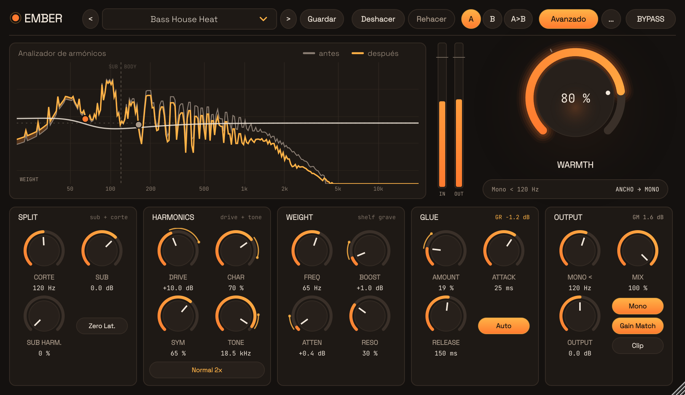

# EMBER — calidez para bajos house

Plugin de efecto (VST3 / AU / Standalone) construido a partir de la especificación
*«EMBER — Especificaciones del plugin VST de calidez para bajos House»*.
C++20 + JUCE 8.0.12.



## Estado

| Qué | Estado |
|---|---|
| Motor DSP completo (5 módulos + Sub Harmonics) | Hecho y probado (`tests/EmberTests.cpp`) |
| Interfaz «brasa» (Simple / Avanzado, analizador, WARMTH, escalado 75–200 %) | Hecha |
| 12 presets de fábrica + presets de usuario en JSON | Hechos (los valores son puntos de partida: hay que afinarlos escuchando) |
| A/B, deshacer/rehacer, bypass con crossfade, estado de sesión | Hecho |
| VST3 + Standalone para **Linux** | Compilado y probado aquí |
| VST3/AU para **macOS**, VST3 para **Windows** | Código listo y workflow de CI incluido, **no compilado todavía** |
| AAX | v1.1 (necesita SDK de Avid y firma PACE/iLok) |
| pluginval | **No ejecutado** (ver «Pruebas») |
| Firma de código / notarización macOS / instalador | Pendiente |
| Prueba 1 de la spec (sonido en bajos reales) | Pendiente: requiere tus oídos |

## Compilar

Requisitos: CMake ≥ 3.22 y un compilador C++20. JUCE se descarga solo (FetchContent)
o se usa una copia local en `./JUCE`.

```bash
cmake -B build -DCMAKE_BUILD_TYPE=Release
cmake --build build --config Release
```

- **Windows**: Visual Studio 2022 → `cmake -B build -G "Visual Studio 17 2022" -A x64`.
  El VST3 queda en `build/Ember_artefacts/Release/VST3/EMBER.vst3` → copiar a `C:\Program Files\Common Files\VST3`.
- **macOS**: genera binario universal (Intel + Apple Silicon), VST3 y AU →
  copiar a `~/Library/Audio/Plug-Ins/VST3` y `~/Library/Audio/Plug-Ins/Components`.
  Sin firmar, Logic/macOS pueden bloquearlo (Gatekeeper): hace falta firmar y notarizar para distribuir.
- **Linux**: dependencias en `.github/workflows/build.yml`.

**CI**: al subir el repo a GitHub, `.github/workflows/build.yml` compila Linux, macOS y Windows,
ejecuta los tests DSP y deja los plugins como artefactos descargables. El workflow no se ha
ejecutado nunca: puede necesitar algún ajuste la primera vez.

Licencia de JUCE: con código cerrado hace falta una licencia de JUCE (comprueba en su web
el tier gratuito por límite de facturación); con código abierto, AGPLv3.

## Estructura

```
Source/
  Parameters.*        IDs estables, rangos, macro WARMTH
  Presets.*           12 presets de fábrica, JSON de usuario
  dsp/Filters.h       SVF TPT (64 bit), Linkwitz-Riley 4, all-pass, shelf SVF, delays
  dsp/Saturator.h     curvas Tube-ish / Tape-ish / Iron-ish con ADAA de 1.er orden, soft clip
  dsp/EmberEngine.*   cadena completa (independiente del wrapper, testeable offline)
  PluginProcessor.*   wrapper JUCE: estado, A/B, presets, bypass, medidores, latencia
  PluginEditor.*, ui/ interfaz
tests/EmberTests.cpp  tests offline del DSP + renders WAV
tools/                EmberHostTest (carga el .vst3 real) y EmberSnapshot (captura de la UI)
```

Cadena de señal:

```
IN ─┬─ SPLIT ─┬─ SUB ─────────── retardo(os) ─┬───────────────────────┐
    │         │                               └─ Sub Harmonics ─┐     │
    │         └─ BODY ─ HARMONICS (oversampling + ADAA) ─ DC ──(+)─ TONE ─ Σ ─ WEIGHT ─ GLUE ─ Gain Match ─┐
    └─ seca: all-pass del crossover (o retardo en Linear Phase) + misma latencia ──────────────── MIX ─ MONO BELOW ─ OUTPUT ─ CLIP
```

## Decisiones que cambian o concretan la especificación

1. **Sub Harmonics redefinido (problema 1 de la revisión).** Con un sub casi sinusoidal, saturar solo
   BODY no hace nada: el test lo confirma. Ninguno de los presets sin Sub Harmonics añade más que
   unos −80 dB de armónicos a un seno de 55 Hz. Ahora «Sub Harmonics» genera 2.º, 3.º y 4.º armónico **a partir del sub limpio**
   (normalizado por su envolvente y doblado de forma asimétrica), los filtra por encima del corte
   (48 dB/oct) y por debajo de ~4× el corte, y los suma a BODY. Al 100 % quedan a −10 dB de la
   fundamental; la fundamental cambia −0,06 dB. Es una octava **hacia arriba**, no un subarmónico.
2. **WARMTH es relativo, con 40 % como punto neutro.** A 40 % los mandos suenan exactamente como están.
   Por encima sube Drive, Character, Boost, Atten y Glue y baja Tone; por debajo, al revés. Los mandos
   conservan su valor (un anillo ámbar muestra el valor efectivo). Así WARMTH no pelea con la
   automatización de los demás parámetros. Los presets se escriben como el **sonido efectivo** de la spec
   y se convierten a valores base para su WARMTH.
3. **Mix 0 %**: la salida es la ruta seca, que es la entrada pasada por el all-pass del crossover
   (Zero Latency) o simplemente retrasada (Linear Phase). Mono Below, Output y Soft Clip están **después** de la mezcla
   (por seguridad en mono), así que la prueba de nulo se hace con ellos neutros.
4. **Gain Match** compara RMS de entrada y salida con ventanas de ~1,5 s, se congela por debajo de
   −70 dBFS, se limita a ±12 dB y se suaviza 0,4 s. Es lento a propósito para no comprimir notas,
   pero sigue siendo dinámico: puede «moverse» en arreglos con mucho silencio. Es una ayuda de escucha.
5. **Calidad**: además de Normal (2×) y HQ (4×) hay **Eco (1×, solo ADAA, 0 muestras de latencia)**.
6. **WEIGHT** usa shelves sobre SVF (Simper) con coeficientes interpolados por muestra y 50 ms de glide:
   un biquad clásico hacía clic al automatizarlo.
7. **Soft Clip** no está sobremuestreado (un ADAA de 1.er orden apagaba los agudos por debajo del umbral).
   Recorta los valores de muestra a −0,3 dBFS; los picos entre muestras pueden pasar de ahí.
8. **Linear Phase**: FIR de ~170 ms (Blackman-Harris), latencia ~85 ms, notificada al DAW.
   El FIR se rediseña fuera del hilo de audio y JUCE hace crossfade al cambiarlo.
9. **Cambiar Phase Mode o Quality** cambia la latencia: el plugin silencia unos milisegundos
   (hasta ~150 ms en Linear Phase) mientras se rellenan los buffers, y avisa al host.
10. **12 presets**: los 6 de la spec más Rolling Garage, Tape Pillow, Iron Pressure, Laptop Rescue,
    Acid Round y Gentle Glue. Al cargar un preset no se cambia la calidad ni el modo de fase.

## Pruebas

`EmberTests` (DSP offline, 48 kHz):

| Prueba | Resultado |
|---|---|
| Nulo con Mix 0 % (6 combinaciones de fase × calidad) | −300 dB (exacto) |
| Suma del crossover plana 20 Hz–5 kHz | ±0,47 dB (1×), ±0,12 dB (2×), ±0,03 dB (4×): la pérdida viene del ADAA cerca de 5 kHz |
| Latencia reportada = medida | Sí en los 6 modos (0 / 31 / 61 / 4096 / 4127 / 4157 muestras) |
| Mono Below 120 Hz | lado en graves −21 dB → −67 dB |
| Sin clics al automatizar cada parámetro (salto extremo cada 50 ms) | artefactos ≥ 60 dB por debajo de la señal |
| Fuzz de parámetros y tamaños de bloque | sin NaN, sin quedarse en silencio |
| Soft Clip | techo −0,30 dBFS |
| CPU, Normal 2×, Zero Latency, estéreo, buffer 256 | **1,8–1,9 %** de un núcleo en un Xeon cloud a 2,1 GHz; objetivo < 2 %, va justo |

`EmberHostTest` carga el **EMBER.vst3 compilado** con el host VST3 de JUCE: 4 frecuencias de muestreo ×
5 tamaños de buffer, fuzz, ida y vuelta del estado, latencia por modo, layout mono y editor
abierto/cerrado con el audio corriendo en otro hilo. Todo pasa.
**No es pluginval**: este entorno no permitió ejecutar el binario de pluginval. Antes de publicar,
pasa pluginval en nivel alto y prueba a mano en Ableton Live, FL Studio, Logic y Reaper (Prueba 3 de la spec).

```bash
cmake -B build -DEMBER_BUILD_TOOLS=ON && cmake --build build
./build/EmberTests_artefacts/Release/EmberTests test-renders            # tests + WAV
./build/EmberHostTest_artefacts/Release/EmberHostTest build/Ember_artefacts/Release/VST3/EMBER.vst3
```

## Uso

- Arrastrar en vertical (Shift = ajuste fino), rueda del ratón o flechas del teclado.
- Doble clic en un mando: valor por defecto. Doble clic en el valor (o clic derecho): escribirlo.
- En modo Avanzado, los dos puntos del analizador mueven WEIGHT (frecuencia/boost y atenuación).
- El indicador bajo WARMTH dice si los graves son mono, antes → después.

Tipografías Space Grotesk y JetBrains Mono, licencia SIL OFL (`resources/fonts/`).
